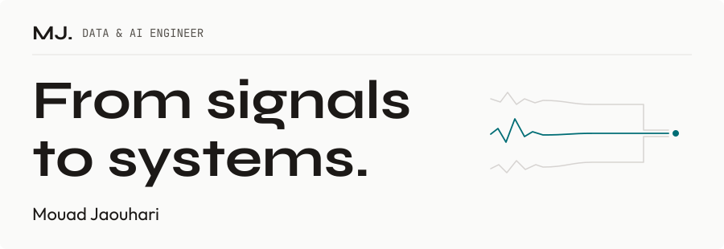
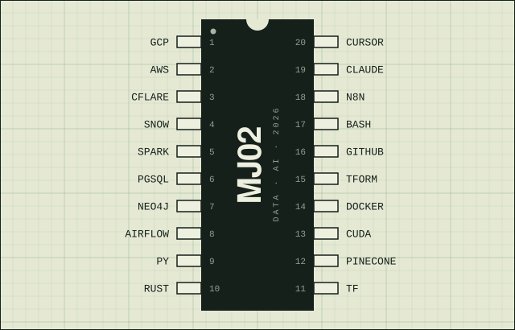

<picture>
  <source media="(max-width: 600px) and (prefers-color-scheme: dark)" srcset="./assets/header-mobile-dark.svg">
  <source media="(max-width: 600px)" srcset="./assets/header-mobile-light.svg">
  <source media="(prefers-color-scheme: dark)" srcset="./assets/header-dark.svg">
  
</picture>

 

I'm **Mouad**, a **Data & AI Engineer at Atos**. I trained in signal and image processing; today I build data platforms, and the agents and tools that work with them.

[Full datasheet ↗](https://mouadja02.github.io/) · [LinkedIn ↗](https://www.linkedin.com/in/j-mouad) · [Kaggle ↗](https://www.kaggle.com/mouadjaouhari) · [Email ↗](mailto:mouadpro02@gmail.com)

### 1 &nbsp; Features

- End-to-end data pipelines on AWS and Snowflake, with infrastructure as code in Terraform.
- Tools for coding agents and data engineers, built in the open and local-first where it matters.
- Machine learning from research to production, including a published IEEE paper on satellite IoT routing.
- Certified: AWS Solutions Architect Associate, SnowPro Core, HashiCorp Terraform Associate.

### 2 &nbsp; Reference designs

| Ref | Design | Function |
| :-- | :-- | :-- |
| 2.1 | **[arkitect](https://github.com/mouadja02/arkitect)** intent → diagram | Your coding agent draws the architecture: editable Draw.io and Excalidraw diagrams built from a small JSON spec, with real product icons. |
| 2.2 | **[dacli](https://github.com/mouadja02/dacli)** intent → tools | A data-engineering agent for the terminal. It writes its own extensions, validates them, and runs every call through a governance gate. |
| 2.3 | **[veritable](https://github.com/mouadja02/veritable)** two tables → proof | A single-binary engine in Rust that proves whether two tables hold the same data, within one database or across different ones. |
| 2.4 | **[murmur](https://github.com/mouadja02/murmur)** voice → useful text | A hotkey turns spoken thoughts into refined text and pastes it at your cursor. Transcription and language models run locally. |
| 2.5 | **[skills](https://github.com/mouadja02/skills)** know-how → instructions | A curated collection of 801 agent skills across 36 categories for Claude Code, Cursor and other clients. |
| 2.6 | **[bitcoin dataset](https://github.com/mouadja02/bitcoin-technical-indicators-dataset)** prices → indicators | Hourly Bitcoin candles with 70+ technical indicators, refreshed daily and published as an open dataset. |

More from the workshop

 

- [chokepoint](https://github.com/mouadja02/chokepoint): a knowledge graph over Python dependencies and security advisories.
- [dag-doctor](https://github.com/mouadja02/dag-doctor): investigates failed Airflow DAGs and proposes fixes.
- [CAG-Lab](https://github.com/mouadja02/CAG-Lab): experiments comparing cache-augmented and retrieval-augmented generation.
- [end2end-datawarehouse-project](https://github.com/mouadja02/end2end-datawarehouse-project): streaming data through Kafka, Spark, AWS Glue and Snowflake.
- [airflow-self-hosted](https://github.com/mouadja02/airflow-self-hosted): a production-style Airflow deployment for a Raspberry Pi.
- [neural-network-cuda](https://github.com/mouadja02/neural-network-cuda): a neural network from scratch, from Python down to CUDA.

### 3 &nbsp; Pin configuration

  <picture>
    <source media="(prefers-color-scheme: dark)" srcset="./assets/pinout-dark.svg">
    
  </picture>

| Type | Pins |
| :-- | :-- |
| Cloud | AWS · GCP · Cloudflare |
| Data | Snowflake · Spark · PostgreSQL · Neo4j · Airflow |
| Languages | Python · Rust · SQL |
| ML / AI | TensorFlow · Pinecone · CUDA · LLM tooling, RAG |
| DevOps | Docker · Terraform · GitHub Actions · Bash |
| Automation and tools | n8n · Claude Code · Cursor |

### 4 &nbsp; Ordering information

Open to collaborations on **data platforms** and **agentic AI**. If you're building in that space, [let's talk](mailto:mouadpro02@gmail.com).

Specifications are subject to continuous improvement without notice.
